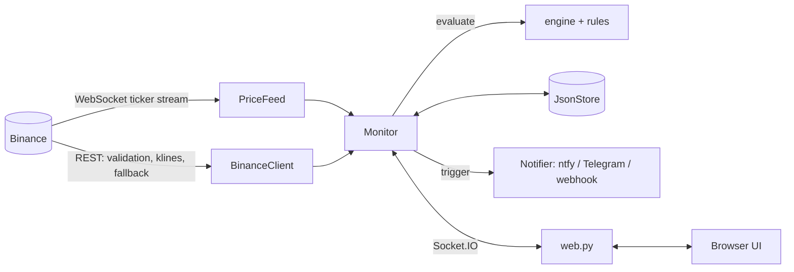

# Crypto Price Alarm

Monitors Binance trading pairs and raises alarms on price events, in the browser and, optionally,
on your phone. Python (Flask + Socket.IO) backend, dependency-free browser UI. Uses Binance's
public market-data API, so no API key is needed.

## Quick start

```
start.bat            # Windows: creates a venv, installs, starts
./start.sh           # macOS / Linux
```

or manually:

```
pip install -e .
python -m crypto_alarm      # then open http://localhost:5000
```

Add any Binance symbol (`BTCUSDT`, `ETHBTC`, `SOLUSDC`, ...). Pairs are validated against
Binance's `exchangeInfo`.

### Docker

```
docker compose up -d
```

Serves on `127.0.0.1:5000` with gunicorn (one worker, state lives in the process) and keeps data
in a named volume. `GET /healthz` reports the price feed state and returns 503 when it is down.

## Alarms

| Type | Fires when |
|------|-----------|
| Target price | the price crosses the target (from below, from above, or either). A new alarm also fires immediately if the price is already beyond the target. A triggered target alarm can be restarted after a 60 s cooldown. |
| % from max / min | the price is X% below the highest / above the lowest price seen since the pair was added (use **Reset max/min** to restart tracking) |
| % move in timeframe | the price moved X% versus one full window ago (minutes, hours or days, up to 7 days), or versus the start price for "since start" (which re-arms itself after every trigger) |

Alarms are evaluated every second on a live price and ignore prices older than two minutes
(those pairs show a **stale** badge). Triggered alarms nobody dismissed are shown again when a
browser connects. The header shows whether prices come from the stream, the REST fallback, or
are down.

## Notifications when no browser is open

| Channel | Variables |
|---------|-----------|
| ntfy | `NTFY_TOPIC` (optional `NTFY_SERVER`) |
| Telegram | `TELEGRAM_BOT_TOKEN` and `TELEGRAM_CHAT_ID` |
| Webhook | `ALARM_WEBHOOK_URL` (receives JSON `{"title", "message"}`) |

Repeat notifications for the same alarm are suppressed for 30 seconds.

## Configuration

Everything is configured through environment variables; [`.env.example`](.env.example) documents
all of them. The server binds to `127.0.0.1` by default. **There is no authentication**: only
bind `0.0.0.0` on a network you trust.

Data is stored in `data/crypto_data_binance.json` inside the project (override with
`CRYPTO_ALARM_DATA`). It is written atomically, and an unreadable file is kept as `.corrupt`.

## Architecture



| Module | Responsibility |
|--------|----------------|
| `settings.py` | all configuration, read once from the environment |
| `models.py` | typed `Asset` / `Alarm` dataclasses and their JSON mapping |
| `rules.py`, `engine.py` | pure validation and trigger logic; message building |
| `formatting.py`, `views.py` | display text and the JSON the browser receives |
| `binance.py` | REST client and WebSocket price feed |
| `monitor.py` | state, operations, evaluation loop |
| `store.py` | atomic JSON persistence |
| `notifier.py` | server-side notifications |
| `web.py` | Flask app factory, Socket.IO events, `/healthz` |

The browser UI (`static/js/*.js`, ES modules) only renders what the server sends; prices,
descriptions and "% till trigger" are all computed server-side.

See [CONTRIBUTING.md](CONTRIBUTING.md) for development.
