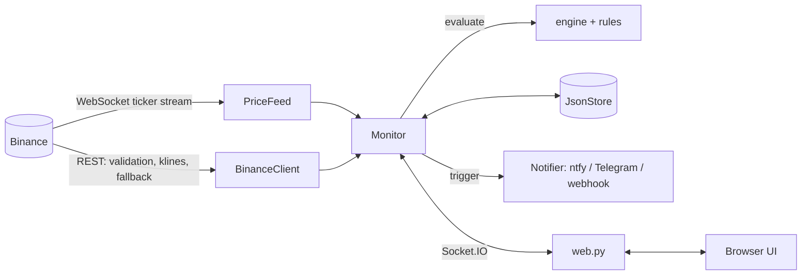

# Implementations

## One App, Server-Side Monitoring

Crypto Price Alarm is a single Python application. A Flask + Socket.IO server does all the work (price streaming, alarm evaluation, persistence, notifications) and the browser is a thin display layer on top of it.

{}
Earlier versions of the project shipped a standalone JavaScript app (CoinGecko, browser `localStorage`, 15-second polling) next to a Python app. That split is gone: there is one implementation, it uses Binance, and it keeps running with no browser open.
{}

## Architecture Overview

**Data Flow**:
1. `PriceFeed` opens one combined Binance WebSocket stream for all monitored pairs
2. Each ticker message updates the pair's price, 24h stats, max/min and price history in `Monitor`
3. Once a second, the monitor loop evaluates every armed alarm against the live price
4. When an alarm fires, the monitor sends notifications and emits an `alarm_triggered` event over Socket.IO
5. Every 2 seconds the monitor pushes the full state to all connected browsers (`price_update`)
6. Changes are persisted to a JSON file with atomic writes

**Philosophy**: The server decides, the browser shows. Prices, descriptions and "% till trigger" are all computed on the server; the browser only renders them and plays the sound.

## Module Map

| Module | Responsibility |
|--------|----------------|
| `settings.py` | all configuration, read once from the environment |
| `models.py` | typed `Asset` / `Alarm` dataclasses and their JSON mapping |
| `rules.py`, `engine.py` | pure validation and trigger logic; message building |
| `formatting.py`, `views.py` | display text and the JSON the browser receives |
| `binance.py` | REST client and WebSocket price feed |
| `monitor.py` | state, operations, evaluation loop |
| `store.py` | atomic JSON persistence |
| `notifier.py` | server-side notifications |
| `web.py` | Flask app factory, Socket.IO events, `/healthz` |
| `__main__.py` | entry point for `python -m crypto_alarm` |

## Design Principles

- **Pure logic, separate state**: `rules.py`, `engine.py` and `formatting.py` take values and return values (no clocks, locks or I/O), so they are tested directly. `Monitor` is the only place that owns shared state.
- **One lock**: all shared state is guarded by a single re-entrant lock. Disk writes and callbacks happen outside it, so a slow disk never stalls price ticks.
- **User errors are `ValueError`s**: messages are safe to show in the UI, and the Socket.IO handler wrapper turns them into `error` events. Anything else is logged and reported as "Internal server error".
- **Single process**: pairs, alarms and price history live in the process, so production runs use exactly one worker.

## Technology Stack

| Layer | Technology |
|-------|-----------|
| Language | Python 3.10+ |
| Web | Flask 3, Flask-SocketIO 5 (`threading` async mode) |
| Price feed | `websocket-client` (stream), `requests` (REST) |
| Production server | gunicorn (`gthread` worker class) |
| Frontend | Plain ES modules, Socket.IO client, Web Audio API |
| Storage | JSON file |
| Tests / quality | `unittest`, `ruff`, `mypy --strict` |

## Next Steps

Explore the detailed documentation:

- **Python App** - server, persistence, Socket.IO events, configuration, deployment
- **Browser UI** - what the interface shows and how alarms are presented
